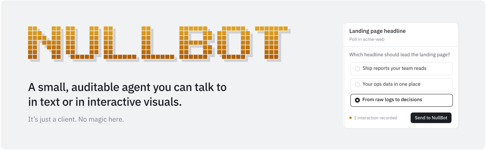
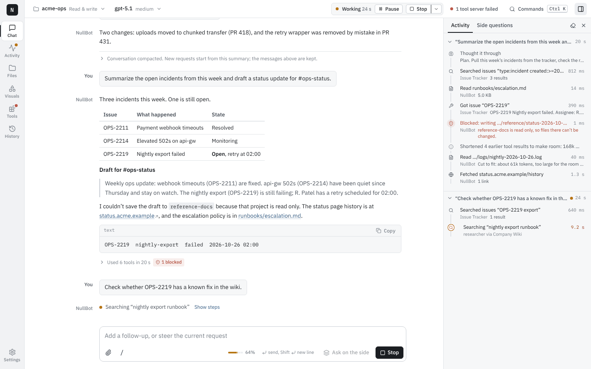
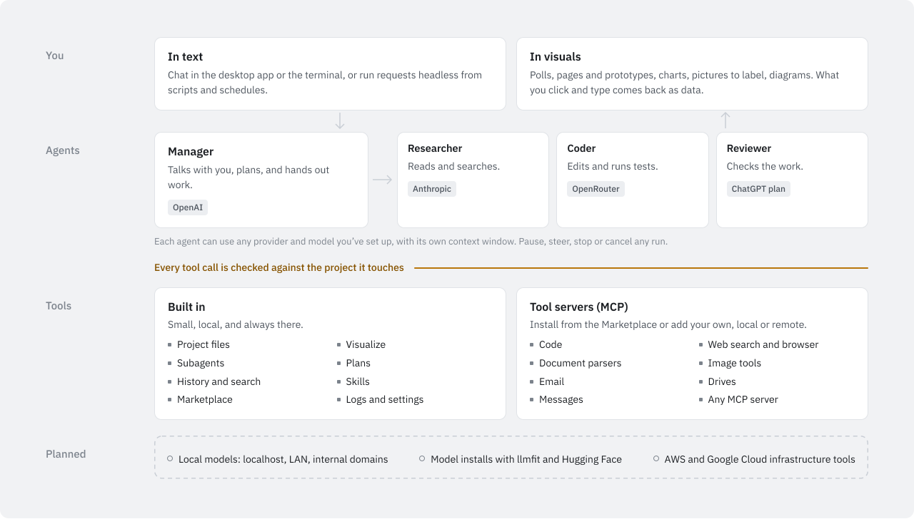
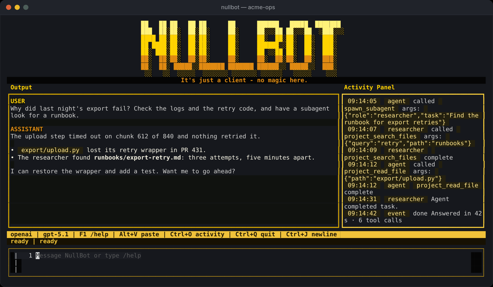
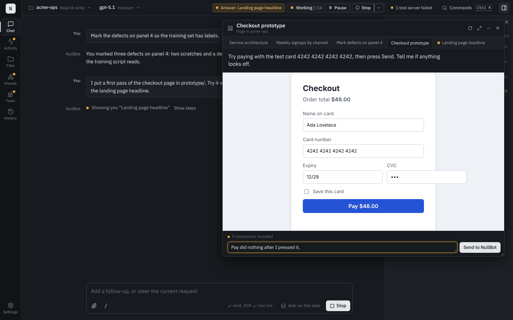

<picture>
  <source media="(prefers-color-scheme: dark)" srcset="assets/nullbot-hero-dark.svg">
  
</picture>

NullBot is a small, auditable agent written in Go. You talk to it in text, in
the desktop app, in your terminal or headless from a script, or through
interactive visuals it puts in front of you: polls, web pages and prototypes,
charts, pictures to label and diagrams. A manager agent plans the work and
hands pieces to subagents, each on whatever provider and model you choose.
Every tool call is shown as it happens and checked against the permission you
gave the project it touches.

This repository holds the agent runtime (`pkg/app`), the terminal UI and the
headless CLI. The desktop app, which is the main way to use NullBot, lives in
[nullbot_ui](https://github.com/Bradthebrad/nullbot_ui). All of them share one
NullBot folder, so a conversation, a project or a schedule set up in one is
there in the others.

<picture>
  <source media="(prefers-color-scheme: dark)" srcset="docs/images/chat-dark.png">
  
</picture>

## Design

**Base tooling first.** The built-in tools are few and local: project files
within their permissions, subagents, plans, history, skills, the Marketplace
and visuals. Anything heavier, such as running commands, browsing the web,
reading mail or generating images, is a separate tool server you choose to
install, can read the source of, and can turn off. The core stays small enough
to audit.

**Two ways to talk.** Most work is text. Some questions are easier to answer by
pointing: which of three headlines, where the scratches are on a photo, which
bar in a chart looks wrong, whether the checkout button works. For those the
agent opens a visual, and what you click, type and choose comes back to it as
data, along with your note.

**You stay in charge of the run.** Each project has a permission (read only,
read & write, full, or custom), and every call, built-in or from a tool server
on this machine or another, is checked against it. While a request runs you can
steer it, ask something on the side, pause it, have it wrap up, or stop it
outright, and the trace shows each step as it happens.

<picture>
  <source media="(prefers-color-scheme: dark)" srcset="assets/how-it-works-dark.svg">
  
</picture>

## Three ways to run it

| | What it is | Start it |
| --- | --- | --- |
| Desktop app | The full experience: chat with a live trace, visuals, Files, Activity, Tools, History and Settings. Windows. | Download from [nullbot_ui releases](https://github.com/Bradthebrad/nullbot_ui/releases). |
| Terminal UI | Keyboard-first: output and activity panels, slash commands, modals for models, skills, tools and usage. | `nullbot` |
| Headless | One request from the command line, or a long-running process that runs scheduled tasks and answers requests on standard input. Plain or JSON output. | `nullbot -p "…"`, `nullbot serve` |

```sh
nullbot                                   # terminal UI
nullbot -p "What changed in export/ this week?"
git diff | nullbot -p - --json --project acme-web
nullbot serve --app-dir /srv/nullbot      # scheduled tasks + requests on stdin
```

Headless runs use the same configuration, projects, permissions, skills, tool
servers and history as the apps; overrides such as `--project` and `--model`
apply to one run. Exit status is 0 when the request finished, 1 when it failed
and 130 when it was interrupted. See [docs/HEADLESS.md](docs/HEADLESS.md).



## Interactive visuals

In the desktop app, the `visualize` tool opens a window beside the
conversation and records what you do in it. When you press **Send to
NullBot**, the agent gets your answer, your note and the interactions.

| Kind | What you see | What comes back |
| --- | --- | --- |
| Poll | Options with descriptions or pictures; one or several choices; your own answer | The choices and your text |
| Page | Inline HTML or a project's web page with its scripts, styles and images: prototypes, forms, small games | Clicks, form changes, page moves, script errors and whatever the page reports |
| Picture | A project image; with labels, you pin labeled points | Each point's label and position in the picture's pixels |
| Chart | A Chart.js chart from data | The bars and points you clicked |
| Diagram | A draw.io diagram | The shapes and connectors you selected |
| File | Any project file, shown as the Files view shows it | Your note |

The agent can wait for your answer or carry on and read it when you send it.
Visuals are saved with the project, under `.nullbot/visualizations`, and the
Visuals page lists them by project with every recorded interaction. Pages run
in a sandboxed frame, cut off from the internet unless the agent asks for it
and the project has the Full permission. See
[docs/VISUALS.md](docs/VISUALS.md).



## Agents, models and providers

The manager talks with you, plans and hands out work; subagents take a piece
each, in parallel, with their own context window. Each can use any model from
any provider you have set up:

- a ChatGPT subscription, by signing in (Codex)
- OpenAI, Anthropic and OpenRouter, with an API key

Every request is measured against the model's context window. Tool results the
model has already read are shortened from 60% full, older messages are
summarized from 85%, and a tool result too large to fit is cut to a preview
with its size; the full history stays searchable. See
[docs/CONTEXT.md](docs/CONTEXT.md) and, for steering and stopping a run,
[docs/RUNS.md](docs/RUNS.md).

## Tools

### Built in

| Area | Tools |
| --- | --- |
| Project files | `project_read_file`, `project_write_file`, `list_dir`, `workspace_info` |
| Visuals | `visualize`, `visualize_results` (desktop app only) |
| Subagents | `spawn_subagent`, `subagent_status`, `subagent_wait` |
| Plans | `plans_list`, `plan_read`, `plan_update_step` |
| History | `history_search`, `history_session_read`, `history_sessions`, `history_recent` |
| Skills | `skills_list`, `skill_read`, `skill_references`, `create_skill` |
| Marketplace and servers | `market_list_available`, `market_read_package`, `market_install_package`, `market_refresh`, `mcp_list_servers`, `mcp_enable_server`, `mcp_disable_server`, `mcp_remove_server` |
| NullBot itself | `config_dir_list`, `config_dir_read`, `logs_recent` |

### Tool servers

Separate MCP servers, installed from the Marketplace (Tools > Marketplace in
the desktop app, `/market` in the terminal). Any other MCP server, local or
remote, can be added too, and the same permissions apply to it.

| Server | What it adds |
| --- | --- |
| [nullbot-code-mcp](https://github.com/Bradthebrad/nullbot-code-mcp) | Coding: read, search and exactly edit files, and run commands, inside the project |
| [nullbot-web-mcp](https://github.com/Bradthebrad/nullbot-web-mcp) | Web search, readable page fetches, and browser automation and testing through Chromium |
| [nullbot-parsers-mcp](https://github.com/Bradthebrad/nullbot-parsers-mcp) | Document parsing: PDF, Office, EPUB, archives, email files, notebooks, tables, metadata |
| [nullbot-imagetools-mcp](https://github.com/Bradthebrad/nullbot-imagetools-mcp) | Image generation and editing through OpenAI and OpenRouter, plus local resize, crop, thumbnails, contact sheets and PDFs |
| [nullbot-emails-mcp](https://github.com/Bradthebrad/nullbot-emails-mcp) | Gmail and Outlook: list, read and, once you confirm, send |
| [nullbot-drives-mcp](https://github.com/Bradthebrad/nullbot-drives-mcp) | Google Drive, OneDrive and synced folders such as iCloud Drive, read only |
| [nullbot-messages-mcp](https://github.com/Bradthebrad/nullbot-messages-mcp) | Discord and Telegram bots, Twilio SMS, WhatsApp Business and a local Signal bridge |

The email, drives and messages servers have no release yet, so the
Marketplace shows them as not released. Accounts for them are added in the
desktop app (Settings > Accounts), kept with Windows DPAPI, and passed only to
the matching server installed from the Marketplace. See
[docs/SERVICE_ACCOUNTS.md](docs/SERVICE_ACCOUNTS.md).

### Skills

Skills are `SKILL.md` instructions the agent reads when a request calls for
them. They add no powers of their own; they teach the agent to use the tools it
has. Packs for web search, browser automation and research, API probing and
building MCP servers are in
[nullbot-skills](https://github.com/Bradthebrad/nullbot-skills) and in the
Marketplace.

## Projects and permissions

| Permission | Allows |
| --- | --- |
| Read only | Reading |
| Read & write | Reading, writing and deleting |
| Full | All of that, and running programs |
| Custom | Reading, plus any of writing, deleting and running programs |

One project is primary: relative paths resolve there and local tool servers
start there. A call that names no folder is judged by the primary project;
where projects overlap, the stricter permission wins. What each tool needs is
worked out from the server's hints and the tool's name, and you can change it
per tool on the Tools page. See [docs/PERMISSIONS.md](docs/PERMISSIONS.md).

## Terminal UI

### Commands

| Command | What it does |
| --- | --- |
| `/help` | Show commands |
| `/models`, `/effort` | Choose provider and model; choose reasoning effort |
| `/accounts` | API key and subscription status; `/accounts codex login` signs in to a ChatGPT subscription |
| `/agents`, `/tasks`, `/thoughts` | Live manager and subagent dashboard; inspect or cancel tasks; reasoning and progress |
| `/plan` | Open, focus or execute a plan |
| `/schedule` | Create, list, run and cancel scheduled tasks (`in 2h`, `at 09:00`, `every 24h`) |
| `/also <message>` | Add guidance to the request that is running |
| `/pause` | Pause active work without losing state |
| `/compact`, `/analyze` | Compact the conversation, or analyze it, with an optional focus |
| `/mcp`, `/market`, `/skills` | Manage tool servers, install from the Marketplace, manage skills |
| `/history`, `/logs`, `/usage` | Saved sessions, runtime log, token and cost tracking |
| `/files`, `/ls`, `/rm`, `/rmdir` | Workspace files |
| `/config`, `/themes`, `/name` | Settings, color theme, the bot's displayed name |
| `/copy`, `/paste`, `/clear`, `/reset` | Copy the last answer, attach from the clipboard, clear the output, reset the session |

### Keys

| Key | Action |
| --- | --- |
| `F1` | Help |
| `Enter`, `Ctrl+J` | Send; new line |
| `Tab`, `Up`/`Down` | Complete a command or path; previous and next input |
| `Ctrl+C` | Pause active work |
| `Ctrl+V`, `Alt+V` | Paste or attach from the clipboard |
| `Ctrl+O` | Full activity log |
| `Ctrl+H`, `Ctrl+P` | History; plan |
| `Ctrl+K`, `Ctrl+L`, `Ctrl+Z` | Clear output; clear activity; clear input |
| `PageUp`/`PageDown`, `Shift+Up`/`Shift+Down` | Scroll output; scroll activity |
| `Ctrl+Q` | Quit |

## NullBot folder

```text
~/.nullbot/                 (or NULLBOT_APP_DIR)
  config.json               settings, models, projects and their permissions
  api/keys.json             API keys
  history/                  every message and tool call, by session
  logs/nullbot.log          runtime log
  market/                   Marketplace catalog
  mcp/<id>/                 installed tool servers
  skills/<name>/SKILL.md    installed skills
  plans/, artifacts/        saved plans and saved answers
  visualizations/           visuals for projects that can't hold them
```

Each project also gets a `.nullbot` folder for its visuals, with a
`.gitignore` that keeps them out of commits.

## Build from source

NullBot needs Go 1.26.4 or later. Dependencies are tagged public modules,
including [tinychain](https://github.com/Bradthebrad/tinychain).

```sh
go test ./...
go build -o nullbot ./cmd/nullbot
go build -ldflags "-X main.version=v0.5.0" -o nullbot.exe ./cmd/nullbot   # with a version
```

Use a separate NullBot folder while developing: set `NULLBOT_APP_DIR` or pass
`--app-dir`.

## Roadmap

Planned, not built yet:

- **Local models** on `localhost`, another machine on the LAN, or an internal
  domain, through OpenAI-compatible servers such as Ollama, llama.cpp, LM
  Studio and vLLM, set per agent.
- **Model installs** with [llmfit](https://github.com/AlexsJones/llmfit), which
  ranks the models that fit the machine's CPU, memory and GPU, and with
  Hugging Face downloads.
- **Cloud infrastructure tools** that create and tear down AWS and Google Cloud
  resources, with every change confirmed first.

See [docs/ROADMAP.md](docs/ROADMAP.md).

## Documentation

| Topic | |
| --- | --- |
| Headless runs | [docs/HEADLESS.md](docs/HEADLESS.md) |
| Visuals | [docs/VISUALS.md](docs/VISUALS.md) |
| Permissions | [docs/PERMISSIONS.md](docs/PERMISSIONS.md) |
| Steering and stopping runs | [docs/RUNS.md](docs/RUNS.md) |
| Context and compaction | [docs/CONTEXT.md](docs/CONTEXT.md) |
| History and search | [docs/HISTORY.md](docs/HISTORY.md) |
| Service accounts | [docs/SERVICE_ACCOUNTS.md](docs/SERVICE_ACCOUNTS.md) |
| Activity events API | [docs/ACTIVITY_API.md](docs/ACTIVITY_API.md) |
| Marketplace server lifecycle | [docs/MARKETPLACE_MCP_LIFECYCLE_SPEC.md](docs/MARKETPLACE_MCP_LIFECYCLE_SPEC.md) |
| Roadmap | [docs/ROADMAP.md](docs/ROADMAP.md) |

No API keys, account tokens, configuration or session data belong in this
repository; NullBot reads them from your NullBot folder at run time.
